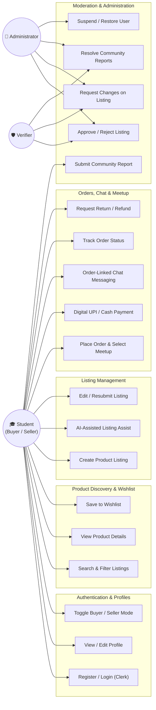
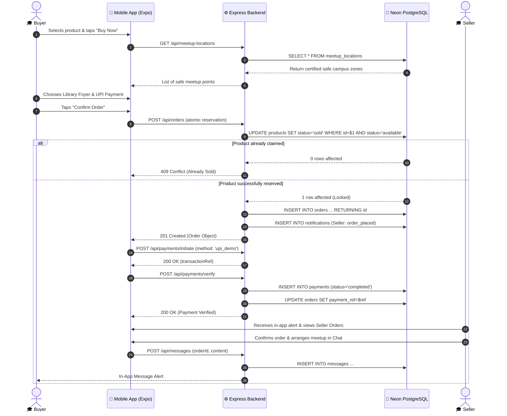
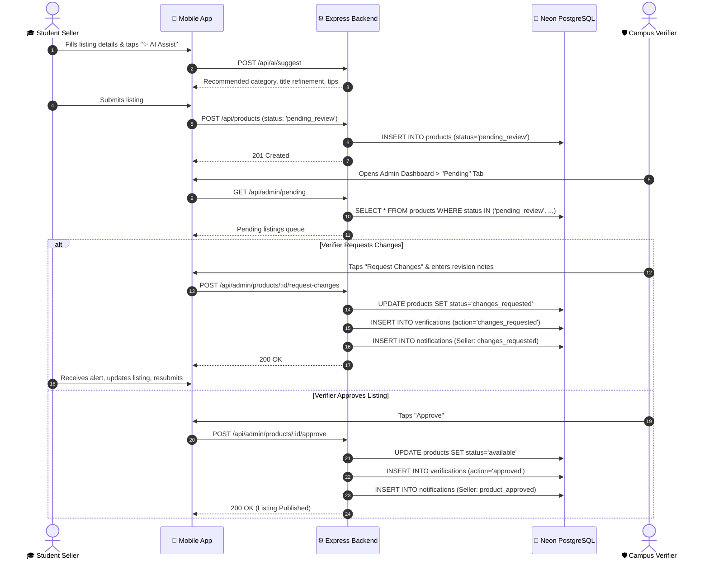
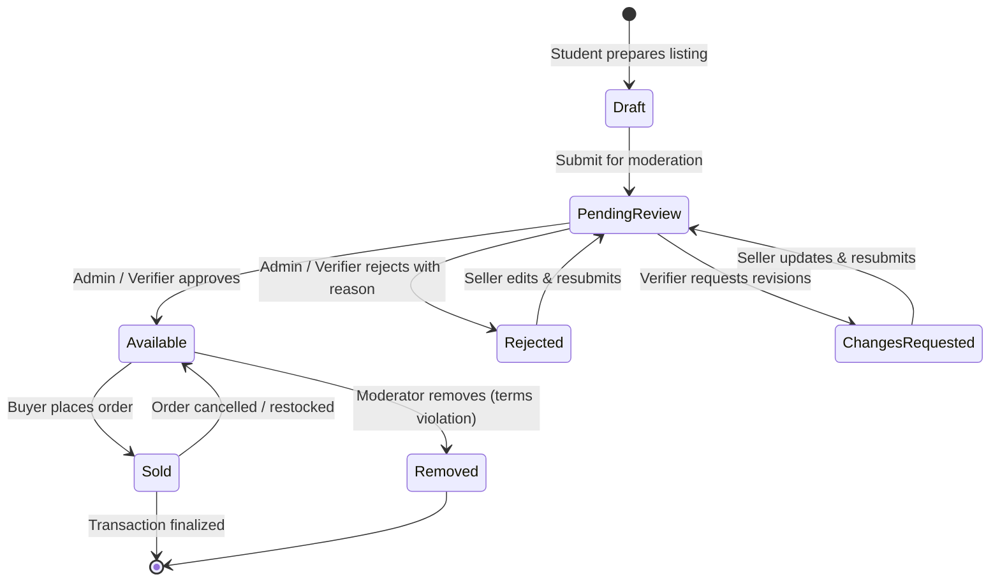
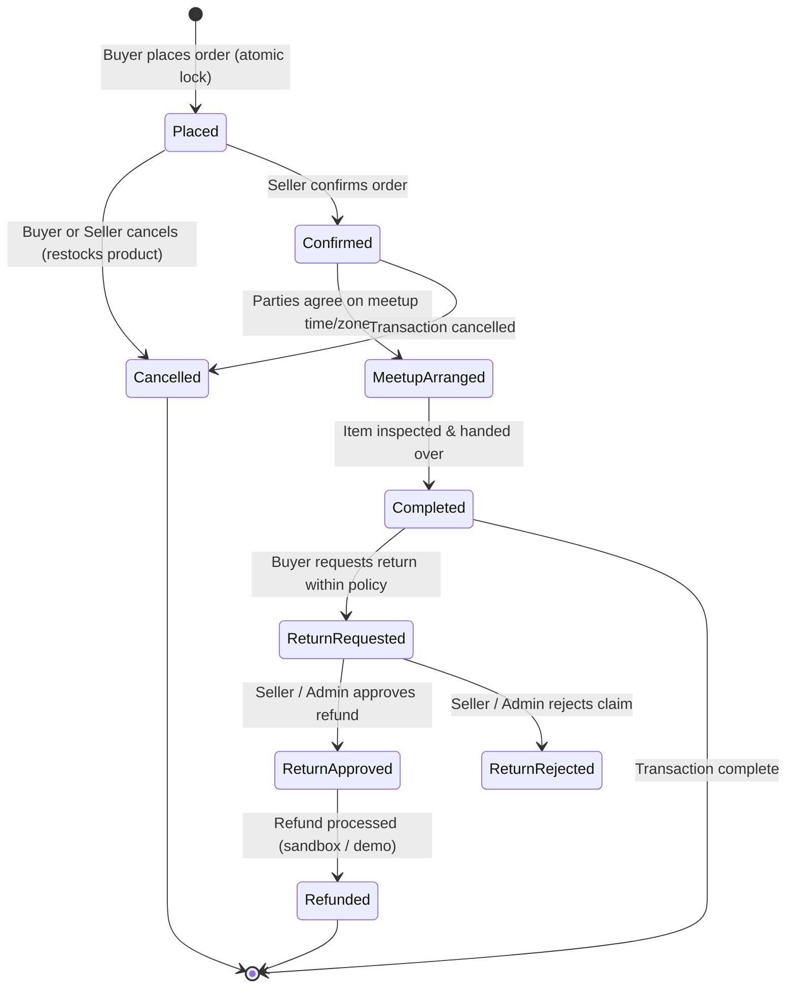
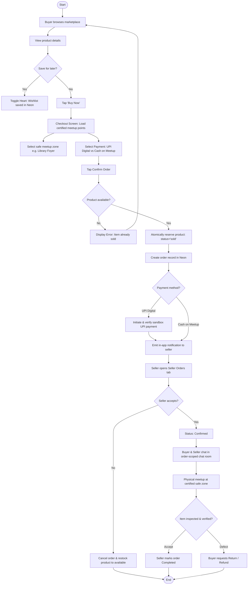
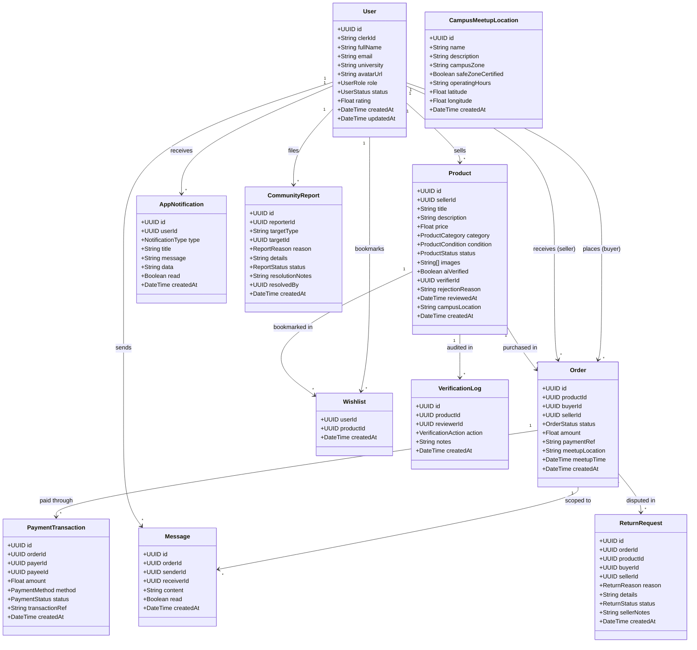

# Campus Marketplace (Unimart) — UML Diagrams Reference

**Course:** Software Development Fundamentals  
**Project:** Campus Marketplace (Unimart) Mobile Application  
**Version:** 3.0  
**Specification Reference:** Campus Marketplace UML Architecture  

---

## 1. Use Case Diagram

---

## 2. Sequence Diagrams

### 2.1 Order Checkout, Meetup Coordination & Digital Payment Flow

### 2.2 Product Verification & Change Request Flow

---

## 3. State Machine Diagrams

### 3.1 Product Listing Lifecycle

### 3.2 Order & Return/Refund Lifecycle

---

## 4. Activity Diagram: Order Placement & Campus Meetup Coordination

---

## 5. Class Diagram (Data Entities & Relationships)

